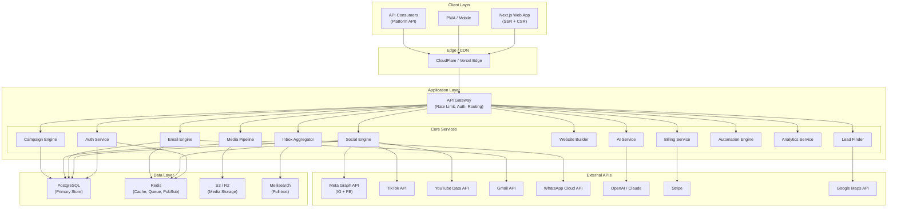
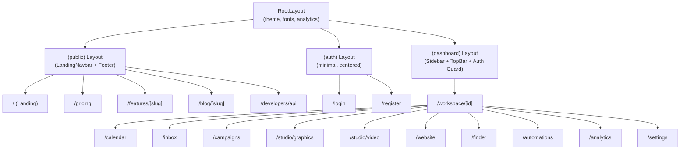
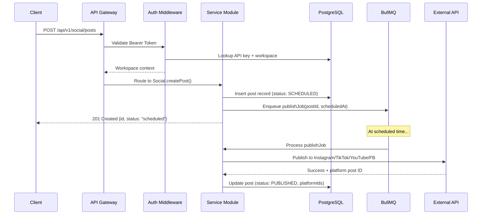
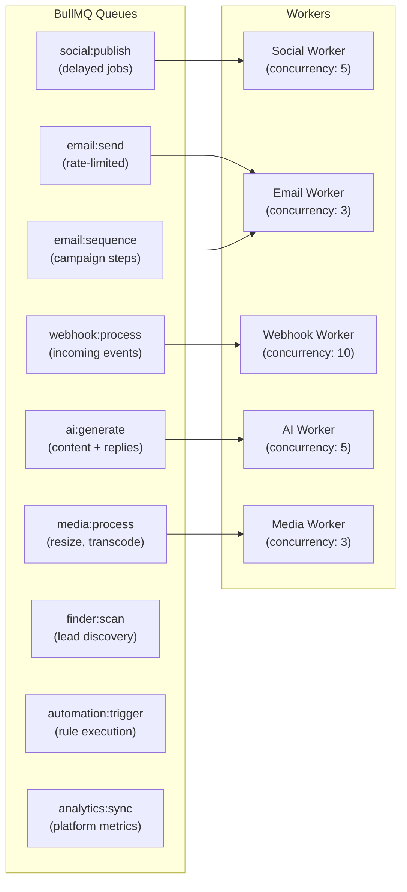
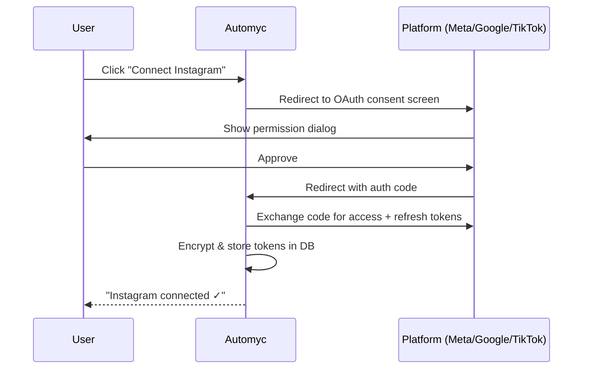
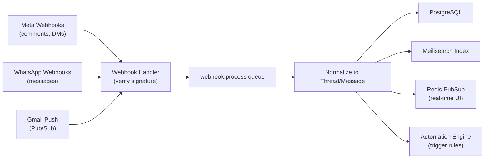
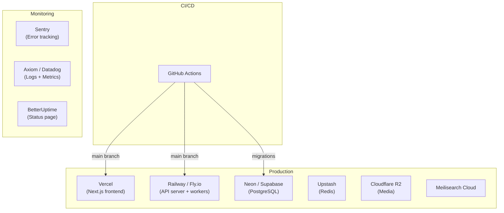

# Architecture.md — Automyc-Clone System Architecture

## 1. High-Level Overview

The platform is an **all-in-one marketing automation SaaS** built as a modular monolith with clear service boundaries, designed to evolve into microservices when scale demands.



---

## 2. Monorepo Structure

```
automyc/
├── apps/
│   ├── web/                    # Next.js 15 App Router (frontend + BFF)
│   │   ├── app/
│   │   │   ├── (public)/       # Marketing pages (/, /pricing, /features/*)
│   │   │   ├── (auth)/         # /login, /register
│   │   │   └── (dashboard)/    # Authenticated app (/workspace/*)
│   │   ├── components/
│   │   │   ├── landing/        # Landing page components
│   │   │   ├── dashboard/      # Dashboard components
│   │   │   └── ui/             # Shared UI primitives (shadcn/ui)
│   │   └── lib/
│   │       ├── api-client.ts   # Typed API client
│   │       └── hooks/          # React hooks
│   │
│   └── api/                    # Backend API server (Fastify)
│       ├── src/
│       │   ├── modules/
│       │   │   ├── auth/
│       │   │   ├── social/
│       │   │   ├── email/
│       │   │   ├── inbox/
│       │   │   ├── ai/
│       │   │   ├── media/
│       │   │   ├── website/
│       │   │   ├── finder/
│       │   │   ├── campaigns/
│       │   │   ├── automations/
│       │   │   ├── analytics/
│       │   │   └── billing/
│       │   ├── middleware/
│       │   ├── queue/          # BullMQ workers
│       │   └── webhooks/       # Platform webhook handlers
│       └── prisma/
│           └── schema.prisma
│
├── packages/
│   ├── shared/                 # Shared types, constants, validators
│   ├── db/                     # Prisma client + migrations
│   ├── queue/                  # BullMQ job definitions
│   ├── ai/                     # AI prompt templates + client
│   └── integrations/           # OAuth + API clients per platform
│       ├── meta/
│       ├── tiktok/
│       ├── youtube/
│       ├── gmail/
│       ├── whatsapp/
│       └── stripe/
│
├── infrastructure/
│   ├── docker-compose.yml
│   ├── Dockerfile.api
│   └── k8s/                    # Kubernetes manifests (later)
│
├── turbo.json
├── package.json
└── .env.example
```

---

## 3. Frontend Architecture

### Next.js App Router Layout



### Theming System

```css
/* CSS custom properties on :root / [data-mk-theme] */
--mk-bg          /* Page background */
--mk-bg-alt      /* Alternate section background */
--mk-surface     /* Card / panel background */
--mk-surface-2   /* Nested surface */
--mk-text        /* Primary text */
--mk-text-muted  /* Secondary text */
--mk-text-subtle /* Tertiary text */
--mk-border      /* Borders */
--mk-brand       /* Primary brand color (emerald-500) */
--mk-brand-text  /* Brand text */
```

Theme toggle persists to `localStorage('mk-theme')` and applies `dark` class to `<html>` via an inline IIFE script (prevents FOUC).

---

## 4. Backend Service Architecture

### Module Responsibility Map

| Service | Responsibility | Key Dependencies |
|---|---|---|
| **Auth** | Registration, login, OAuth flows, API key management, session handling | PostgreSQL, Redis (sessions) |
| **Social** | Post CRUD, scheduling, publishing to platforms, comment sync | Meta API, TikTok API, YouTube API, BullMQ |
| **Email** | Email sending, thread management, push notification handling | Gmail API, BullMQ |
| **Inbox** | Unified thread aggregation, labeling, assignment, search | PostgreSQL, Meilisearch, Redis PubSub |
| **AI** | Content generation, reply drafting, brand knowledge context | OpenAI/Claude API, credit metering |
| **Media** | Upload, resize, transcode, CDN URL generation | S3/R2, Sharp, FFmpeg |
| **Website** | Page CRUD, block-based editing, publishing, domain management | PostgreSQL, S3 (static hosting) |
| **Finder** | Lead search, business enrichment, dataset building | Google Maps API, web scraping |
| **Campaigns** | Email sequence orchestration, recipient management, tracking | BullMQ, Gmail API |
| **Automations** | Rule engine for comment-to-DM, follow-to-DM, auto-reply | Redis (event bus), BullMQ |
| **Analytics** | Metric aggregation, platform data sync, dashboard queries | PostgreSQL (materialized views) |
| **Billing** | Subscription management, plan enforcement, credit wallet | Stripe API |

### Request Flow



---

## 5. Queue Architecture



---

## 6. External Integration Architecture

### OAuth Flow (All Platforms)



### Webhook Ingestion



---

## 7. Infrastructure & Deployment



### Environment Matrix

| Service | Development | Staging | Production |
|---|---|---|---|
| Frontend | localhost:3000 | staging.automyc.com | automyc.com |
| API | localhost:4000 | api-staging.automyc.com | api.automyc.com |
| Database | Docker PostgreSQL | Neon branch | Neon main |
| Redis | Docker Redis | Upstash staging | Upstash production |
| Storage | Local filesystem | R2 staging bucket | R2 production bucket |

---

## 8. Key Architectural Decisions

| Decision | Choice | Rationale |
|---|---|---|
| Monolith vs Microservices | **Modular monolith** first | Faster iteration, single deploy, split later |
| REST vs GraphQL | **REST** with OpenAPI | Simpler for API consumers, better caching |
| SSR vs SPA | **Hybrid** (RSC + CSR) | Marketing pages SSR for SEO, dashboard CSR for interactivity |
| Queue system | **BullMQ + Redis** | Reliable delayed jobs, rate limiting, retries |
| Database | **PostgreSQL** | Multi-tenant, JSON columns, full-text search fallback |
| ORM | **Prisma** | Type safety, migrations, introspection |
| Auth | **Custom + OAuth** | Full control over token scoping, API key system |
| AI Provider | **OpenAI (primary) + Claude (fallback)** | Best content quality, fallback for availability |
| File storage | **Cloudflare R2** | S3-compatible, no egress fees |
