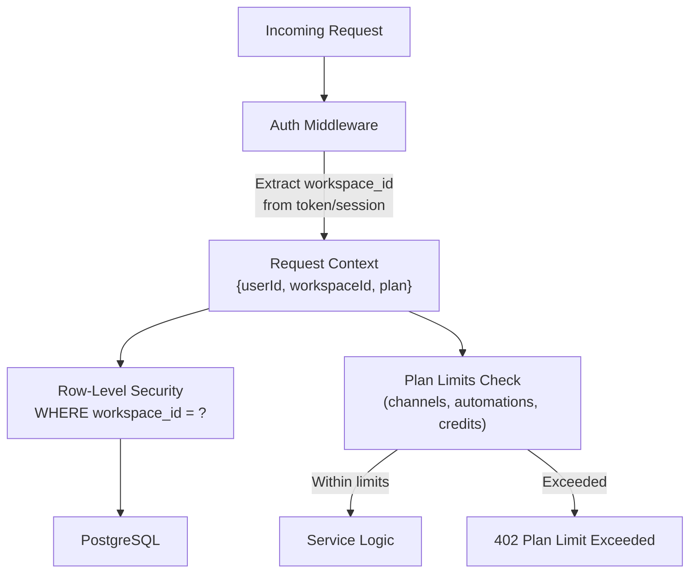
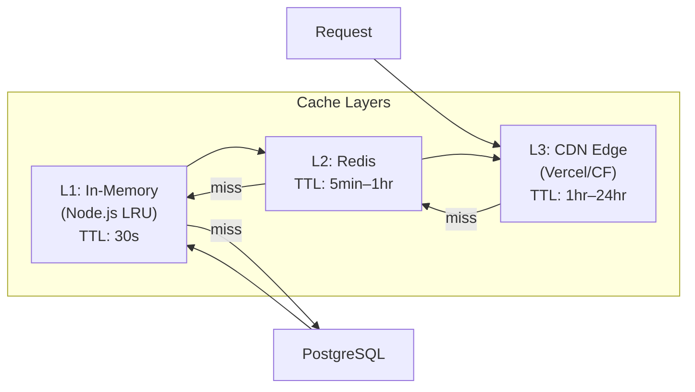
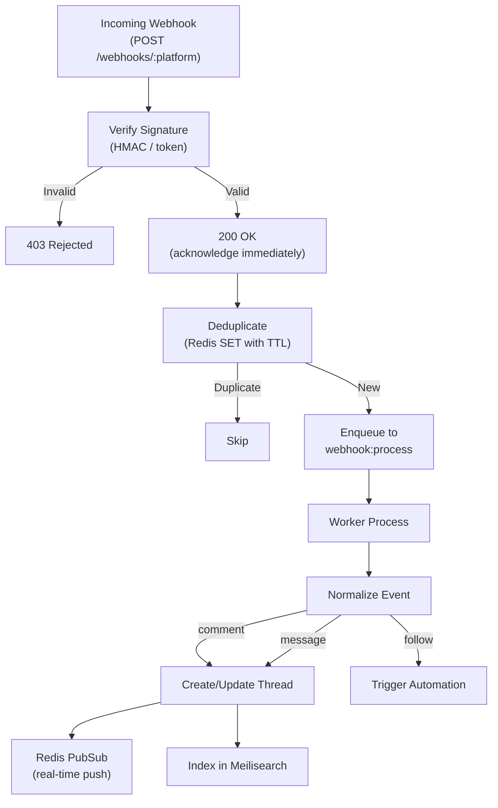
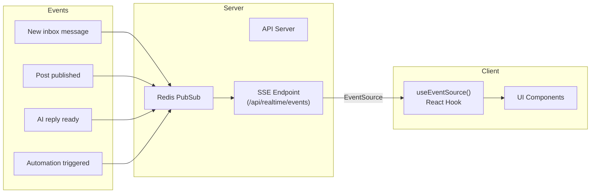
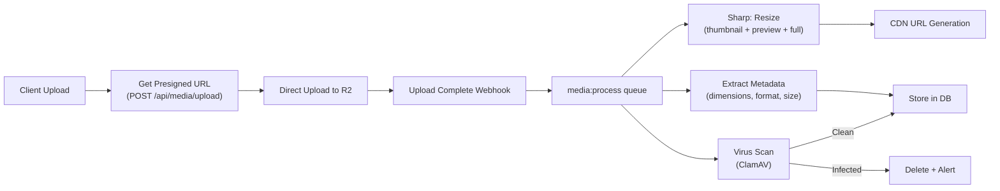
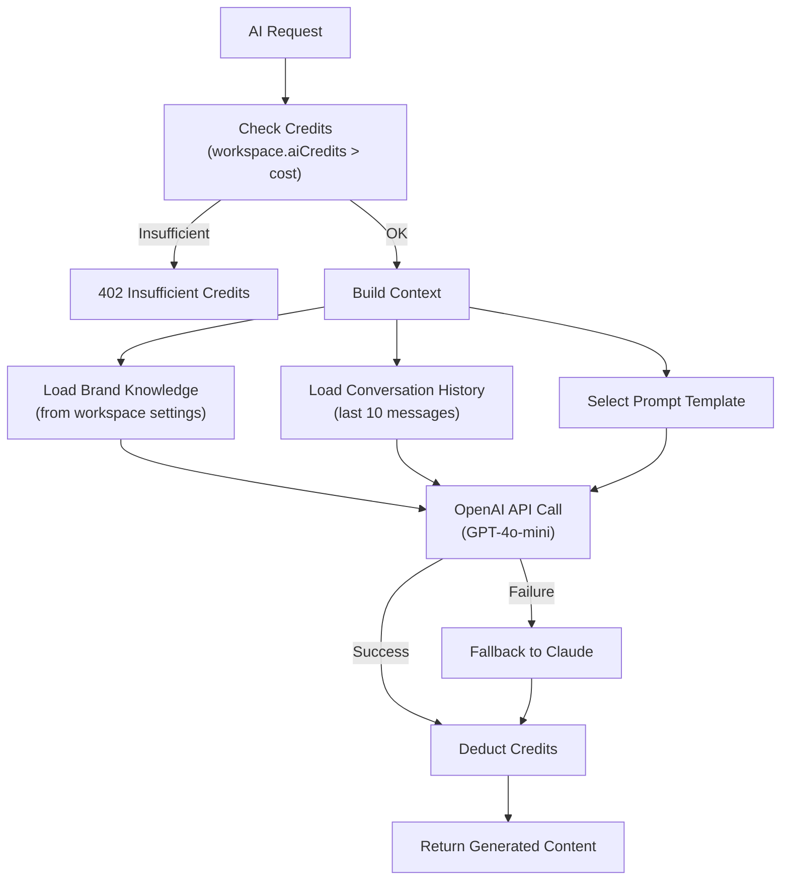
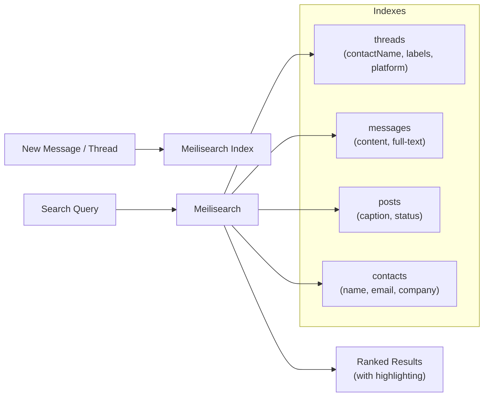

# System Design.md — Scalability, Reliability & Performance

## 1. Capacity Estimation

### User Scale Targets

| Metric | Launch | Year 1 | Year 3 |
|---|---|---|---|
| Registered users | 500 | 5,000 | 50,000 |
| DAU | 100 | 1,000 | 10,000 |
| Connected channels | 1,000 | 15,000 | 150,000 |
| Posts scheduled/day | 500 | 10,000 | 100,000 |
| Inbox messages/day | 2,000 | 50,000 | 500,000 |
| AI requests/day | 300 | 5,000 | 50,000 |
| Media uploads/day | 200 | 5,000 | 50,000 |

### Storage Estimation (Year 1)

| Data Type | Size per Unit | Volume | Total |
|---|---|---|---|
| Post records | ~2 KB | 3.6M/year | ~7 GB |
| Messages | ~1 KB | 18M/year | ~18 GB |
| Media files | ~2 MB avg | 1.8M/year | ~3.6 TB |
| Analytics events | ~0.5 KB | 50M/year | ~25 GB |
| **Total DB** | | | **~50 GB** |
| **Total Media** | | | **~3.6 TB** |

---

## 2. Multi-Tenancy Design



### Tenant Isolation Strategy

| Layer | Strategy |
|---|---|
| **Database** | Shared database, shared schema, `workspace_id` on every table, RLS policies |
| **Queue** | Jobs tagged with `workspaceId`, per-tenant rate limiting |
| **Cache** | Redis keys prefixed with `ws:{workspaceId}:` |
| **Storage** | S3/R2 paths: `/{workspaceId}/media/{fileId}` |
| **Rate Limits** | Per-workspace API rate limits based on plan |

### Plan Enforcement Middleware

```typescript
// middleware/planLimits.ts
async function enforcePlanLimits(ctx: RequestContext) {
  const workspace = await getWorkspace(ctx.workspaceId);
  const plan = PLANS[workspace.planId];
  
  const checks = {
    channels: await countChannels(ctx.workspaceId) < plan.maxChannels,
    automations: await countActiveAutomations(ctx.workspaceId) < plan.maxAutomations,
    aiCredits: workspace.aiCredits > 0,
    workspaces: await countWorkspaces(ctx.userId) < plan.maxWorkspaces,
  };
  
  return checks;
}
```

---

## 3. Caching Architecture



### Cache Key Design

```
# Session/Auth
session:{sessionToken}           → UserSession      TTL: 24h
apikey:{keyHash}                 → ApiKeyContext     TTL: 5min

# Workspace
ws:{id}:plan                     → PlanDetails       TTL: 1h
ws:{id}:channels                 → Channel[]         TTL: 5min
ws:{id}:credits                  → CreditBalance     TTL: 1min

# Social
ws:{id}:calendar:{year}-{month}  → Post[]           TTL: 2min
post:{id}:metrics                → PostMetrics       TTL: 15min

# Inbox
ws:{id}:inbox:unread             → count            TTL: 30s
thread:{id}:messages             → Message[]        TTL: 1min
```

### Cache Invalidation Strategy

| Event | Invalidation |
|---|---|
| Post created/updated/deleted | `ws:{id}:calendar:*` |
| New inbox message | `ws:{id}:inbox:unread`, `thread:{id}:messages` |
| Channel connected/disconnected | `ws:{id}:channels` |
| AI credit consumed | `ws:{id}:credits` |
| Subscription changed | `ws:{id}:plan` |

---

## 4. Rate Limiting Design

### API Rate Limits

| Plan | Requests/min | Burst | Publishing/hour |
|---|---|---|---|
| Free Trial | 60 | 10 | 10 |
| Starter | 120 | 20 | 30 |
| Scale | 300 | 50 | 100 |
| API Keys | 600 | 100 | 200 |

### Implementation (Token Bucket via Redis)

```typescript
// Sliding window rate limiter
async function rateLimit(workspaceId: string, limit: number, windowMs: number) {
  const key = `ratelimit:${workspaceId}`;
  const now = Date.now();
  
  const pipeline = redis.pipeline();
  pipeline.zremrangebyscore(key, 0, now - windowMs);
  pipeline.zadd(key, now, `${now}:${crypto.randomUUID()}`);
  pipeline.zcard(key);
  pipeline.expire(key, Math.ceil(windowMs / 1000));
  
  const results = await pipeline.exec();
  const count = results[2][1] as number;
  
  if (count > limit) {
    throw new RateLimitError(limit, windowMs);
  }
}
```

### Platform-Specific Rate Limits

| Platform | Publish Limit | API Rate Limit |
|---|---|---|
| Instagram | 25 posts/day per account | 200 calls/hour |
| Facebook | 50 posts/day per page | 200 calls/hour |
| TikTok | 1 video/day via API | 100 calls/day |
| YouTube | 6 videos/day | 10,000 units/day |
| Gmail | 500 emails/day (free) | 250 quota units/sec |
| WhatsApp | Template-based limits | 80 messages/sec |

---

## 5. Webhook Processing Pipeline



### Webhook Retry Strategy

```
Attempt 1: Immediate
Attempt 2: 30 seconds
Attempt 3: 2 minutes
Attempt 4: 10 minutes
Attempt 5: 1 hour
→ Move to dead letter queue after 5 failures
```

---

## 6. Real-Time Architecture



### Channel Design

```
# Redis PubSub channels
events:ws:{workspaceId}          # All workspace events
events:ws:{workspaceId}:inbox    # Inbox-specific events
events:ws:{workspaceId}:social   # Social-specific events
```

### Event Payload Schema

```typescript
interface RealtimeEvent {
  type: 'inbox.message' | 'post.published' | 'ai.reply_ready' | 'automation.triggered';
  workspaceId: string;
  timestamp: string;
  data: {
    id: string;
    [key: string]: unknown;
  };
}
```

---

## 7. Media Pipeline



### Image Size Variants

| Variant | Max Width | Quality | Use Case |
|---|---|---|---|
| `thumb` | 150px | 70% | Grid thumbnails |
| `preview` | 600px | 80% | Feed previews |
| `full` | 1920px | 90% | Full-size display |
| `original` | Unchanged | 100% | Download / publishing |

---

## 8. AI Service Design



### Credit Costs

| Action | Credits | Description |
|---|---|---|
| Draft reply | 1 | Generate inbox reply suggestion |
| Generate caption | 1 | Social post caption |
| Rewrite content | 1 | Improve existing text |
| AI assistant action | 2 | Complex multi-step task |
| Lead search | 2 | AI-powered lead enrichment |
| Generate image | 5 | DALL-E image generation |
| Generate video | 10 | AI video generation |

---

## 9. Search Architecture



### Filterable Attributes

```json
{
  "threads": {
    "filterableAttributes": ["workspaceId", "platform", "labels", "isRead"],
    "sortableAttributes": ["lastMessageAt", "createdAt"],
    "searchableAttributes": ["contactName", "lastMessagePreview"]
  }
}
```

---

## 10. Disaster Recovery & High Availability

| Component | Strategy | RPO | RTO |
|---|---|---|---|
| **Database** | Neon point-in-time recovery + daily snapshots | 1 min | 5 min |
| **Redis** | Upstash with replication | 0 (replicated) | < 1 min |
| **Media Storage** | R2 cross-region replication | 0 | 0 |
| **Application** | Vercel multi-region, Railway auto-restart | N/A | < 2 min |
| **Queue** | BullMQ with Redis persistence + dead letter | 0 | < 1 min |

### Backup Schedule

```
Database:  Continuous WAL archiving + daily full snapshot (30-day retention)
Redis:     RDB snapshots every 5 minutes
Media:     Cross-region replication (automatic)
Configs:   Git-tracked, environment variables in Vercel/Railway
```

### Failover Procedures

1. **Database failure** → Neon auto-promotes read replica, app retries
2. **Redis failure** → Upstash auto-failover, app degrades gracefully (no cache = slower)
3. **API server crash** → Railway auto-restarts, Vercel function cold-starts
4. **External API down** → Queue retries with exponential backoff, user sees "publishing" state
5. **Full region outage** → DNS failover to secondary deployment (manual, < 15 min)
