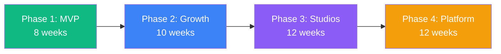

# Phases.md — Development Roadmap & Sprint Plan

## Overview Timeline

---

## Phase 1: MVP — Social Publishing + Inbox (8 Weeks)

**Goal:** Launch a working product where users can connect Instagram/Facebook, schedule posts, manage inbox, and subscribe.

### Sprint 1 (Week 1–2): Foundation

| Task | Details | Owner |
|---|---|---|
| Project setup | Monorepo (Turborepo), Next.js 15, Prisma, Tailwind, shadcn/ui | Fullstack |
| Database schema | Users, Workspaces, Channels, Posts, Threads, Messages | Backend |
| Auth system | NextAuth v5, Google OAuth, email/password, session management | Backend |
| Landing page | Hero section, features overview, footer, responsive | Frontend |
| Register/Login pages | Forms with validation, error handling | Frontend |
| CI/CD pipeline | GitHub Actions → Vercel (frontend), Railway (API) | DevOps |

**Milestone:** User can register, login, and see an empty dashboard.

### Sprint 2 (Week 3–4): Channel Connection + Post Creation

| Task | Details | Owner |
|---|---|---|
| Meta OAuth flow | Instagram + Facebook Business connection via Meta Graph API | Backend |
| Channel management UI | Connect/disconnect channels, status display | Frontend |
| Token encryption | AES-256-GCM for OAuth tokens at rest | Backend |
| Post creation form | Caption editor, media upload (R2 presigned URLs), platform selector | Frontend |
| Media upload pipeline | Presigned URL generation, Sharp resizing, metadata extraction | Backend |
| Post CRUD API | Create, read, update, delete posts | Backend |

**Milestone:** User can connect Instagram, create a post with an image and caption.

### Sprint 3 (Week 5–6): Calendar + Publishing Engine

| Task | Details | Owner |
|---|---|---|
| Content calendar UI | Month/week/day views, post cards, status badges | Frontend |
| Drag-to-reschedule | React DnD for calendar rescheduling | Frontend |
| Scheduling engine | Inngest delayed functions, scheduled-at execution | Backend |
| Instagram publishing | Publish image/carousel to IG via Graph API | Backend |
| Facebook publishing | Publish to FB Page via Graph API | Backend |
| Publishing status | DRAFT → SCHEDULED → PUBLISHING → PUBLISHED/FAILED | Backend |

**Milestone:** Scheduled posts publish automatically to Instagram and Facebook.

### Sprint 4 (Week 7–8): Inbox + AI + Billing + Launch

| Task | Details | Owner |
|---|---|---|
| Webhook setup | Meta webhook subscription for comments + DMs | Backend |
| Inbox thread view | Thread list, message detail, reply compose | Frontend |
| AI reply drafting | OpenAI integration, brand context, reply suggestions | Backend |
| Basic analytics | Per-post reach/engagement from platform APIs | Backend |
| Stripe integration | Checkout, webhooks, subscription management, trial logic | Backend |
| Billing UI | Plan display, upgrade button, Stripe portal link | Frontend |
| Pricing page | Plan comparison, billing toggle, CTA | Frontend |
| Bug fixes + polish | Cross-browser testing, error states, loading skeletons | Both |
| **Launch** | Deploy to production, monitoring setup, status page | DevOps |

**Milestone: 🚀 MVP LAUNCH — Product is live and accepting users.**

### Phase 1 → Phase 2 Go/No-Go Criteria

- [ ] ≥50 registered users
- [ ] ≥10 channels connected
- [ ] ≥5 posts published successfully
- [ ] ≥3 paying subscribers
- [ ] Error rate < 1%
- [ ] P95 response time < 500ms

---

## Phase 2: Growth Features (10 Weeks)

**Goal:** Add TikTok + YouTube, email outreach, WhatsApp, and social automations.

### Sprint 5 (Week 9–10): TikTok + YouTube

| Task | Details |
|---|---|
| TikTok OAuth + publishing | TikTok Login Kit, Content Posting API |
| YouTube OAuth + publishing | Google OAuth, YouTube Data API v3 video upload |
| Multi-platform post UI | Updated post form with TikTok/YouTube options |
| Platform-specific formatting | Video requirements per platform, aspect ratio guides |

### Sprint 6 (Week 11–12): Email Outreach

| Task | Details |
|---|---|
| Gmail OAuth connection | Gmail API read/send/watch scopes |
| Email composer | Rich text editor, template variables, preview |
| Sequence builder | Multi-step campaign with delays (1 day, 3 days, etc.) |
| Reply detection | Gmail push notifications, auto-stop sequence on reply |
| Campaign analytics | Open rate (pixel), click rate (link wrapping), reply rate |

### Sprint 7 (Week 13–14): WhatsApp Integration

| Task | Details |
|---|---|
| WhatsApp Business API setup | Meta Business Manager, phone number verification |
| Message templates | Create and submit templates for approval |
| Two-way messaging | Inbound webhooks → inbox, outbound replies |
| Broadcast campaigns | Send template messages to contact lists |

### Sprint 8 (Week 15–16): Automations Engine

| Task | Details |
|---|---|
| Automation builder UI | Visual rule editor (trigger → condition → action) |
| Comment auto-reply | Trigger on new comment, AI-generated reply |
| Comment-to-DM | Trigger on keyword in comment → send DM |
| Follow-to-DM | Trigger on new follower → welcome DM |
| Auto DM | Trigger on DM keyword → automated response |
| Execution history | Logs of automation runs with success/failure |

### Sprint 9 (Week 17–18): Multi-Workspace + Polish

| Task | Details |
|---|---|
| Multi-workspace support | Workspace switcher, per-workspace billing |
| Team invitations | Invite by email, role-based permissions (admin/editor/viewer) |
| Onboarding flow | Guided setup wizard for new users |
| Performance optimization | Database indexes, query optimization, caching |

**Phase 2 Milestone:** Full social publishing (4 platforms), email outreach, WhatsApp, automations.

---

## Phase 3: Creative Studios (12 Weeks)

**Goal:** Add graphics studio, video studio, website builder, and AI Finder.

### Sprint 10–11 (Week 19–22): Graphics Studio

| Task | Details |
|---|---|
| Canvas engine | Fabric.js or Konva.js layered editor |
| Template system | Pre-built templates for IG feed, story, FB post, YT thumbnail |
| Brand kit | Upload logo, set brand colors and fonts |
| Text tools | Add text, font selection, alignment, effects |
| Image tools | Upload images, filters, crop, layers |
| Export + schedule | Export PNG/JPG, "Schedule this" → creates post |

### Sprint 12–13 (Week 23–26): Video Studio

| Task | Details |
|---|---|
| AI video generation | Text-to-video via Runway/Pika/custom pipeline |
| Timeline editor | Clip arrangement, trimming, splitting |
| Auto-captions | Whisper API for speech-to-text, SRT overlay |
| Music library | Royalty-free tracks, volume control |
| Voice-over | Text-to-speech generation |
| Export formats | MP4 for TikTok, YouTube, Instagram Reels |

### Sprint 14–15 (Week 27–30): Website Builder + AI Finder

| Task | Details |
|---|---|
| Block-based editor | GrapeJS or custom React DnD blocks |
| AI page generation | Generate page content from business description |
| Template library | Landing page, about, contact, portfolio templates |
| Custom domains | CNAME setup, SSL provisioning (Let's Encrypt) |
| AI Finder | Google Maps search, email enrichment, dataset builder |
| Dataset management | CRUD for contact lists, CSV export, field management |

**Phase 3 Milestone:** All 8 product modules are live.

---

## Phase 4: Platform Maturity (12 Weeks)

**Goal:** Platform API, mobile app, enterprise features, self-hosted option.

### Sprint 16–17 (Week 31–34): Platform API

| Task | Details |
|---|---|
| API key management | Create/revoke keys with scoped permissions |
| OpenAPI spec | Auto-generated from route handlers |
| API documentation | Interactive docs page with examples |
| Webhook delivery | Allow users to receive events via webhooks |
| Rate limiting per key | Token bucket per API key |

### Sprint 18–19 (Week 35–38): Mobile App

| Task | Details |
|---|---|
| React Native app | Expo, shared API client |
| Core screens | Inbox, calendar, post creation, notifications |
| Push notifications | New message, post published, automation triggered |
| App Store submission | iOS + Android review process |

### Sprint 20–21 (Week 39–42): Enterprise + Self-Hosted

| Task | Details |
|---|---|
| Self-hosted Docker | Docker Compose with all services |
| Admin panel | User management, usage analytics, system health |
| SSO (SAML/OIDC) | Enterprise single sign-on |
| Audit log | Track all API actions for compliance |
| Data export | Full workspace data export (GDPR compliance) |
| SLA dashboard | Uptime monitoring, incident history |

**Phase 4 Milestone: 🏁 Platform is enterprise-ready with API, mobile, and self-hosted options.**

---

## Team Scaling Plan

| Phase | Team Size | Roles |
|---|---|---|
| Phase 1 | 1–2 | Fullstack developer(s) |
| Phase 2 | 2–3 | + Backend developer |
| Phase 3 | 3–5 | + Frontend developer + Designer |
| Phase 4 | 5–8 | + Mobile developer + DevOps + QA |

---

## Risk Register

| Risk | Impact | Mitigation |
|---|---|---|
| Meta API approval delays | Blocks IG/FB publishing | Apply early, use sandbox for development |
| TikTok API restrictions | Limited publishing features | Build for manual posting fallback |
| AI costs exceed budget | Erodes margins | Aggressive caching, model downgrade option |
| OAuth token expiry bugs | Publishing failures | Proactive token refresh, alerting |
| Platform rate limits hit | Degraded service | Queue with backpressure, per-account limits |
| Scope creep | Delays launch | Strict MVP scope, PM sign-off |
