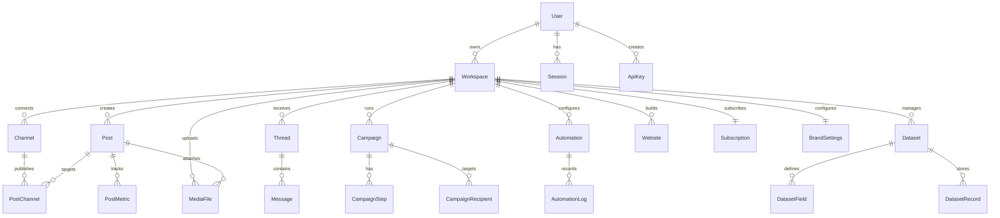

# Database.md — Complete Database Schema & Design

## 1. Entity-Relationship Diagram



---

## 2. Complete Prisma Schema

```prisma
// prisma/schema.prisma

generator client {
  provider = "prisma-client-js"
}

datasource db {
  provider = "postgresql"
  url      = env("DATABASE_URL")
}

// ============================================================
// AUTH & USERS
// ============================================================

model User {
  id            String      @id @default(cuid())
  email         String      @unique
  passwordHash  String?
  name          String?
  avatarUrl     String?
  emailVerified DateTime?
  
  workspaces    WorkspaceMember[]
  sessions      Session[]
  apiKeys       ApiKey[]
  auditLogs     AuditLog[]
  
  createdAt     DateTime    @default(now())
  updatedAt     DateTime    @updatedAt

  @@index([email])
}

model Session {
  id           String   @id @default(cuid())
  userId       String
  user         User     @relation(fields: [userId], references: [id], onDelete: Cascade)
  token        String   @unique
  expiresAt    DateTime
  ipAddress    String?
  userAgent    String?
  createdAt    DateTime @default(now())

  @@index([token])
  @@index([userId])
}

model ApiKey {
  id            String   @id @default(cuid())
  userId        String
  user          User     @relation(fields: [userId], references: [id], onDelete: Cascade)
  workspaceId   String
  workspace     Workspace @relation(fields: [workspaceId], references: [id], onDelete: Cascade)
  name          String
  keyHash       String   @unique   // SHA-256 of the key
  keyPrefix     String             // First 8 chars for display
  scopes        String[]           // ["social:read", "social:write", ...]
  lastUsedAt    DateTime?
  expiresAt     DateTime?
  isActive      Boolean  @default(true)
  createdAt     DateTime @default(now())

  @@index([keyHash])
  @@index([workspaceId])
}

// ============================================================
// WORKSPACES & TEAMS
// ============================================================

model Workspace {
  id            String      @id @default(cuid())
  name          String
  slug          String      @unique
  logoUrl       String?
  
  members       WorkspaceMember[]
  channels      Channel[]
  posts         Post[]
  threads       Thread[]
  campaigns     Campaign[]
  automations   Automation[]
  datasets      Dataset[]
  websites      Website[]
  mediaFiles    MediaFile[]
  apiKeys       ApiKey[]
  subscription  Subscription?
  brandSettings BrandSettings?
  auditLogs     AuditLog[]
  
  aiCredits     Int         @default(100)
  trialEndsAt   DateTime
  
  createdAt     DateTime    @default(now())
  updatedAt     DateTime    @updatedAt

  @@index([slug])
}

model WorkspaceMember {
  id            String    @id @default(cuid())
  workspaceId   String
  workspace     Workspace @relation(fields: [workspaceId], references: [id], onDelete: Cascade)
  userId        String
  user          User      @relation(fields: [userId], references: [id], onDelete: Cascade)
  role          MemberRole @default(EDITOR)
  joinedAt      DateTime  @default(now())

  @@unique([workspaceId, userId])
  @@index([userId])
}

model BrandSettings {
  id            String    @id @default(cuid())
  workspaceId   String    @unique
  workspace     Workspace @relation(fields: [workspaceId], references: [id], onDelete: Cascade)
  
  businessName  String?
  industry      String?
  description   String?    // Used as AI context
  tone          String?    // "friendly", "professional", "casual"
  knowledge     String?    @db.Text  // Business FAQ / knowledge base
  primaryColor  String?
  secondaryColor String?
  fontFamily    String?
  logoUrl       String?
  
  updatedAt     DateTime  @updatedAt
}

// ============================================================
// CHANNELS (Connected Social/Email/WhatsApp Accounts)
// ============================================================

model Channel {
  id              String    @id @default(cuid())
  workspaceId     String
  workspace       Workspace @relation(fields: [workspaceId], references: [id], onDelete: Cascade)
  
  platform        Platform
  platformAccountId String  // Platform's user/page/account ID
  name            String    // Display name (e.g., "@mybrand")
  username        String?
  avatarUrl       String?
  
  // Encrypted OAuth tokens
  accessToken     String    @db.Text
  refreshToken    String?   @db.Text
  tokenExpiresAt  DateTime?
  tokenScopes     String[]
  
  // Platform-specific metadata
  metadata        Json?     // Page ID, business account flag, etc.
  
  isActive        Boolean   @default(true)
  lastSyncAt      DateTime?
  
  postChannels    PostChannel[]
  threads         Thread[]
  
  createdAt       DateTime  @default(now())
  updatedAt       DateTime  @updatedAt

  @@unique([workspaceId, platform, platformAccountId])
  @@index([workspaceId])
  @@index([platform])
}

// ============================================================
// SOCIAL POSTS & PUBLISHING
// ============================================================

model Post {
  id            String      @id @default(cuid())
  workspaceId   String
  workspace     Workspace   @relation(fields: [workspaceId], references: [id], onDelete: Cascade)
  
  caption       String      @db.Text
  mediaFiles    PostMedia[]
  hashtags      String[]
  
  status        PostStatus  @default(DRAFT)
  scheduledAt   DateTime?
  publishedAt   DateTime?
  
  // AI-generated metadata
  aiGenerated   Boolean     @default(false)
  aiPrompt      String?
  
  channels      PostChannel[]
  metrics       PostMetric[]
  
  createdAt     DateTime    @default(now())
  updatedAt     DateTime    @updatedAt

  @@index([workspaceId, status])
  @@index([workspaceId, scheduledAt])
  @@index([scheduledAt, status])
}

model PostMedia {
  id            String    @id @default(cuid())
  postId        String
  post          Post      @relation(fields: [postId], references: [id], onDelete: Cascade)
  mediaFileId   String
  mediaFile     MediaFile @relation(fields: [mediaFileId], references: [id])
  position      Int       @default(0)  // Order in carousel

  @@index([postId])
}

model PostChannel {
  id              String    @id @default(cuid())
  postId          String
  post            Post      @relation(fields: [postId], references: [id], onDelete: Cascade)
  channelId       String
  channel         Channel   @relation(fields: [channelId], references: [id], onDelete: Cascade)
  
  platformPostId  String?   // ID returned by platform after publishing
  status          PostStatus @default(DRAFT)
  error           String?
  publishedAt     DateTime?
  
  @@unique([postId, channelId])
  @@index([channelId])
}

model PostMetric {
  id            String    @id @default(cuid())
  postId        String
  post          Post      @relation(fields: [postId], references: [id], onDelete: Cascade)
  channelId     String
  
  impressions   Int       @default(0)
  reach         Int       @default(0)
  likes         Int       @default(0)
  comments      Int       @default(0)
  shares        Int       @default(0)
  saves         Int       @default(0)
  clicks        Int       @default(0)
  
  fetchedAt     DateTime  @default(now())

  @@index([postId])
  @@index([fetchedAt])
}

// ============================================================
// UNIFIED INBOX
// ============================================================

model Thread {
  id              String    @id @default(cuid())
  workspaceId     String
  workspace       Workspace @relation(fields: [workspaceId], references: [id], onDelete: Cascade)
  channelId       String
  channel         Channel   @relation(fields: [channelId], references: [id], onDelete: Cascade)
  
  platform        Platform
  platformThreadId String   // Platform's conversation/comment ID
  threadType      ThreadType // DM, COMMENT, EMAIL, WHATSAPP
  
  contactName     String
  contactUsername  String?
  contactAvatar   String?
  contactEmail    String?
  
  subject         String?   // For email threads
  lastMessageAt   DateTime
  lastMessagePreview String?
  messageCount    Int       @default(0)
  
  isRead          Boolean   @default(false)
  isArchived      Boolean   @default(false)
  isStarred       Boolean   @default(false)
  labels          String[]
  assignedTo      String?   // User ID
  
  messages        Message[]
  
  createdAt       DateTime  @default(now())
  updatedAt       DateTime  @updatedAt

  @@unique([workspaceId, platform, platformThreadId])
  @@index([workspaceId, isRead, lastMessageAt])
  @@index([workspaceId, platform])
  @@index([workspaceId, labels])
  @@index([lastMessageAt])
}

model Message {
  id              String    @id @default(cuid())
  threadId        String
  thread          Thread    @relation(fields: [threadId], references: [id], onDelete: Cascade)
  
  direction       Direction // INBOUND, OUTBOUND
  content         String    @db.Text
  contentType     ContentType @default(TEXT) // TEXT, IMAGE, VIDEO, AUDIO
  
  platformMsgId   String?
  senderName      String?
  senderAvatar    String?
  
  // AI metadata
  aiGenerated     Boolean   @default(false)
  aiConfidence    Float?
  
  attachments     Json?     // [{url, type, name, size}]
  
  sentAt          DateTime  @default(now())
  deliveredAt     DateTime?
  readAt          DateTime?

  @@index([threadId, sentAt])
}

// ============================================================
// EMAIL CAMPAIGNS
// ============================================================

model Campaign {
  id            String    @id @default(cuid())
  workspaceId   String
  workspace     Workspace @relation(fields: [workspaceId], references: [id], onDelete: Cascade)
  
  name          String
  subject       String
  fromChannelId String    // Gmail channel to send from
  
  status        CampaignStatus @default(DRAFT)
  
  steps         CampaignStep[]
  recipients    CampaignRecipient[]
  
  // Analytics
  totalSent     Int       @default(0)
  totalOpened   Int       @default(0)
  totalClicked  Int       @default(0)
  totalReplied  Int       @default(0)
  totalBounced  Int       @default(0)
  
  startedAt     DateTime?
  completedAt   DateTime?
  createdAt     DateTime  @default(now())
  updatedAt     DateTime  @updatedAt

  @@index([workspaceId, status])
}

model CampaignStep {
  id            String    @id @default(cuid())
  campaignId    String
  campaign      Campaign  @relation(fields: [campaignId], references: [id], onDelete: Cascade)
  
  stepNumber    Int
  subject       String?   // Override campaign subject
  body          String    @db.Text  // HTML email body with {{variables}}
  delayDays     Int       @default(0)  // Days after previous step
  
  @@unique([campaignId, stepNumber])
}

model CampaignRecipient {
  id            String    @id @default(cuid())
  campaignId    String
  campaign      Campaign  @relation(fields: [campaignId], references: [id], onDelete: Cascade)
  
  email         String
  firstName     String?
  lastName      String?
  company       String?
  variables     Json?     // Custom merge fields
  
  status        RecipientStatus @default(PENDING)
  currentStep   Int       @default(0)
  
  lastSentAt    DateTime?
  openedAt      DateTime?
  clickedAt     DateTime?
  repliedAt     DateTime?
  bouncedAt     DateTime?
  unsubscribedAt DateTime?
  
  @@unique([campaignId, email])
  @@index([campaignId, status])
}

// ============================================================
// AUTOMATIONS
// ============================================================

model Automation {
  id            String    @id @default(cuid())
  workspaceId   String
  workspace     Workspace @relation(fields: [workspaceId], references: [id], onDelete: Cascade)
  
  name          String
  type          AutomationType // COMMENT_REPLY, COMMENT_TO_DM, FOLLOW_TO_DM, AUTO_DM
  channelId     String    // Which channel this automation applies to
  
  trigger       Json      // {event, conditions: [{field, operator, value}]}
  action        Json      // {type, template, useAi, aiPrompt}
  
  isActive      Boolean   @default(false)
  
  totalRuns     Int       @default(0)
  totalSuccess  Int       @default(0)
  totalFailed   Int       @default(0)
  
  logs          AutomationLog[]
  
  createdAt     DateTime  @default(now())
  updatedAt     DateTime  @updatedAt

  @@index([workspaceId, isActive])
  @@index([channelId])
}

model AutomationLog {
  id            String    @id @default(cuid())
  automationId  String
  automation    Automation @relation(fields: [automationId], references: [id], onDelete: Cascade)
  
  triggerEvent  Json      // The event that triggered this
  actionResult  Json?     // What was sent/done
  status        String    // SUCCESS, FAILED, SKIPPED
  error         String?
  
  executedAt    DateTime  @default(now())

  @@index([automationId, executedAt])
}

// ============================================================
// DATASETS (CRM)
// ============================================================

model Dataset {
  id            String    @id @default(cuid())
  workspaceId   String
  workspace     Workspace @relation(fields: [workspaceId], references: [id], onDelete: Cascade)
  
  name          String
  description   String?
  
  fields        DatasetField[]
  records       DatasetRecord[]
  recordCount   Int       @default(0)
  
  createdAt     DateTime  @default(now())
  updatedAt     DateTime  @updatedAt

  @@index([workspaceId])
}

model DatasetField {
  id            String    @id @default(cuid())
  datasetId     String
  dataset       Dataset   @relation(fields: [datasetId], references: [id], onDelete: Cascade)
  
  name          String    // "email", "firstName", "company"
  type          FieldType // TEXT, EMAIL, PHONE, URL, NUMBER, DATE, BOOLEAN
  isRequired    Boolean   @default(false)
  position      Int       @default(0)

  @@unique([datasetId, name])
}

model DatasetRecord {
  id            String    @id @default(cuid())
  datasetId     String
  dataset       Dataset   @relation(fields: [datasetId], references: [id], onDelete: Cascade)
  
  data          Json      // {email: "...", firstName: "...", ...}
  source        String?   // "ai_finder", "csv_import", "manual", "api"
  
  createdAt     DateTime  @default(now())
  updatedAt     DateTime  @updatedAt

  @@index([datasetId])
}

// ============================================================
// WEBSITES
// ============================================================

model Website {
  id            String    @id @default(cuid())
  workspaceId   String
  workspace     Workspace @relation(fields: [workspaceId], references: [id], onDelete: Cascade)
  
  name          String
  subdomain     String    @unique  // {subdomain}.automyc.site
  customDomain  String?   @unique
  
  pages         WebsitePage[]
  
  isPublished   Boolean   @default(false)
  publishedAt   DateTime?
  
  createdAt     DateTime  @default(now())
  updatedAt     DateTime  @updatedAt

  @@index([workspaceId])
  @@index([subdomain])
  @@index([customDomain])
}

model WebsitePage {
  id            String    @id @default(cuid())
  websiteId     String
  website       Website   @relation(fields: [websiteId], references: [id], onDelete: Cascade)
  
  title         String
  slug          String    // "about", "contact", etc.
  blocks        Json      // Block-based content structure
  seoTitle      String?
  seoDescription String?
  isHomepage    Boolean   @default(false)
  position      Int       @default(0)
  
  @@unique([websiteId, slug])
}

// ============================================================
// MEDIA FILES
// ============================================================

model MediaFile {
  id            String    @id @default(cuid())
  workspaceId   String
  workspace     Workspace @relation(fields: [workspaceId], references: [id], onDelete: Cascade)
  
  filename      String
  mimeType      String
  sizeBytes     Int
  width         Int?
  height        Int?
  durationMs    Int?      // For video/audio
  
  storageKey    String    // R2/S3 object key
  cdnUrl        String    // Public CDN URL
  thumbnailUrl  String?
  
  postMedia     PostMedia[]
  
  createdAt     DateTime  @default(now())

  @@index([workspaceId])
}

// ============================================================
// BILLING
// ============================================================

model Subscription {
  id              String    @id @default(cuid())
  workspaceId     String    @unique
  workspace       Workspace @relation(fields: [workspaceId], references: [id], onDelete: Cascade)
  
  stripeCustomerId    String    @unique
  stripeSubscriptionId String?  @unique
  stripePriceId       String?
  
  plan            PlanType  @default(TRIAL)
  billingCycle    BillingCycle?
  status          SubStatus @default(TRIALING)
  
  currentPeriodStart DateTime?
  currentPeriodEnd   DateTime?
  cancelAtPeriodEnd  Boolean  @default(false)
  
  createdAt       DateTime  @default(now())
  updatedAt       DateTime  @updatedAt
}

// ============================================================
// AUDIT LOG
// ============================================================

model AuditLog {
  id            String    @id @default(cuid())
  workspaceId   String
  workspace     Workspace @relation(fields: [workspaceId], references: [id], onDelete: Cascade)
  userId        String?
  user          User?     @relation(fields: [userId], references: [id])
  
  action        String    // "post.created", "channel.connected", etc.
  resourceType  String    // "post", "channel", "campaign", etc.
  resourceId    String?
  metadata      Json?     // Additional context
  ipAddress     String?
  
  createdAt     DateTime  @default(now())

  @@index([workspaceId, createdAt])
  @@index([workspaceId, action])
  @@index([resourceType, resourceId])
}

// ============================================================
// ENUMS
// ============================================================

enum Platform {
  INSTAGRAM
  FACEBOOK
  TIKTOK
  YOUTUBE
  GMAIL
  WHATSAPP
}

enum PostStatus {
  DRAFT
  SCHEDULED
  PUBLISHING
  PUBLISHED
  FAILED
}

enum Direction {
  INBOUND
  OUTBOUND
}

enum ContentType {
  TEXT
  IMAGE
  VIDEO
  AUDIO
  FILE
}

enum ThreadType {
  DM
  COMMENT
  EMAIL
  WHATSAPP
}

enum MemberRole {
  OWNER
  ADMIN
  EDITOR
  VIEWER
}

enum CampaignStatus {
  DRAFT
  ACTIVE
  PAUSED
  COMPLETED
  CANCELLED
}

enum RecipientStatus {
  PENDING
  SENDING
  SENT
  OPENED
  CLICKED
  REPLIED
  BOUNCED
  UNSUBSCRIBED
}

enum AutomationType {
  COMMENT_REPLY
  COMMENT_TO_DM
  FOLLOW_TO_DM
  AUTO_DM
  KEYWORD_REPLY
}

enum FieldType {
  TEXT
  EMAIL
  PHONE
  URL
  NUMBER
  DATE
  BOOLEAN
}

enum PlanType {
  TRIAL
  STARTER
  SCALE
  ENTERPRISE
}

enum BillingCycle {
  MONTHLY
  YEARLY
}

enum SubStatus {
  TRIALING
  ACTIVE
  PAST_DUE
  CANCELLED
  EXPIRED
}
```

---

## 3. Indexing Strategy

| Table | Index | Purpose |
|---|---|---|
| `Post` | `(workspaceId, scheduledAt, status)` | Calendar query |
| `Thread` | `(workspaceId, isRead, lastMessageAt DESC)` | Inbox list |
| `Message` | `(threadId, sentAt)` | Thread detail |
| `CampaignRecipient` | `(campaignId, status)` | Campaign progress |
| `AutomationLog` | `(automationId, executedAt DESC)` | Execution history |
| `AuditLog` | `(workspaceId, createdAt DESC)` | Activity feed |

---

## 4. Data Retention Policy

| Data | Retention | Justification |
|---|---|---|
| Active user data | Indefinite | Business requirement |
| Deleted workspace data | 30 days (soft delete) | Recovery window |
| Audit logs | 1 year | Compliance |
| Automation logs | 90 days | Debugging |
| Post metrics history | 2 years | Analytics |
| Media files (deleted posts) | 7 days | Storage cost |
| Sessions (expired) | 7 days | Cleanup |

---

## 5. Migration Strategy

```bash
# Development
npx prisma migrate dev --name <migration_name>

# Staging (preview)
npx prisma migrate deploy   # via CI/CD

# Production
npx prisma migrate deploy   # via CI/CD with approval gate
```

All migrations are forward-only. Destructive changes require a two-step migration (add new → migrate data → remove old).
