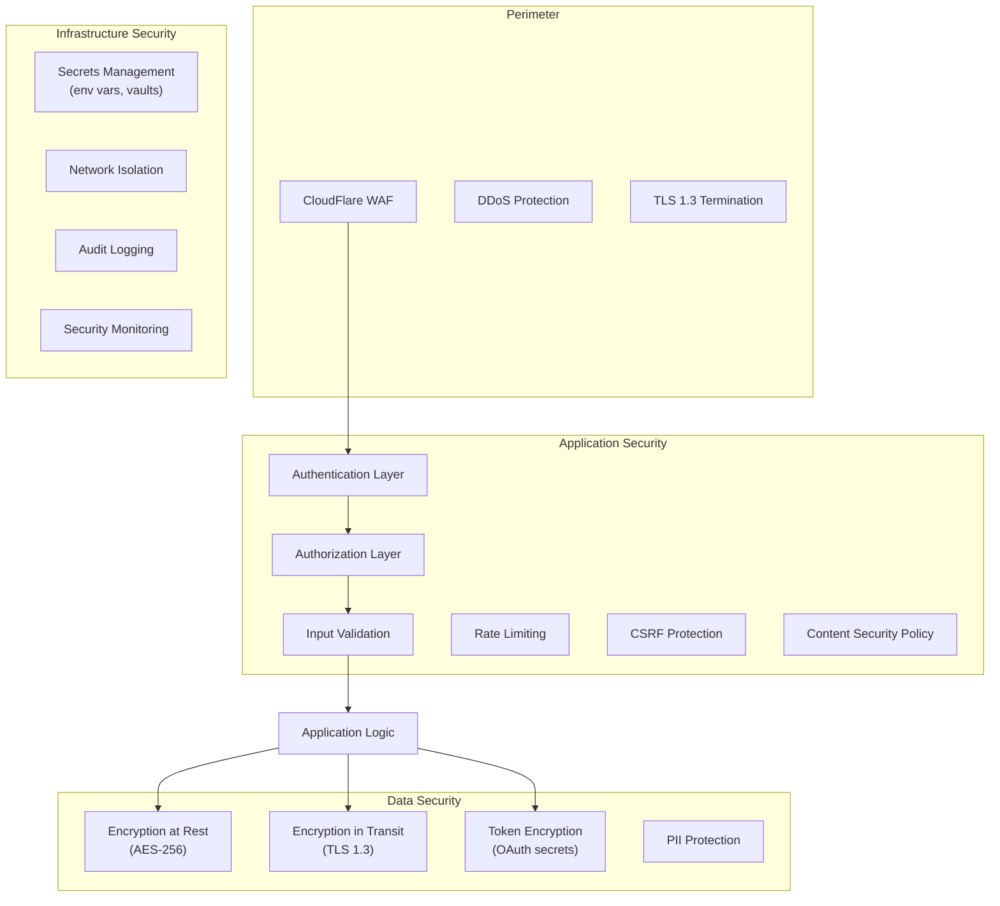

# Security.md — Security Architecture & Controls

## 1. Security Architecture Overview



---

## 2. Authentication

### 2.1 Session-Based Auth (Web App)

```typescript
// NextAuth.js v5 configuration
export const authConfig = {
  providers: [
    CredentialsProvider({
      // Email + password with bcrypt (cost factor 12)
      authorize: async (credentials) => {
        const user = await findUserByEmail(credentials.email);
        if (!user || !await bcrypt.compare(credentials.password, user.passwordHash)) {
          throw new AuthError('Invalid credentials');
        }
        return user;
      }
    }),
    GoogleProvider({
      clientId: process.env.GOOGLE_CLIENT_ID,
      clientSecret: process.env.GOOGLE_CLIENT_SECRET,
    }),
  ],
  session: {
    strategy: 'jwt',
    maxAge: 24 * 60 * 60,      // 24 hours
    updateAge: 60 * 60,         // Refresh every hour
  },
  cookies: {
    sessionToken: {
      options: {
        httpOnly: true,
        sameSite: 'lax',
        path: '/',
        secure: true,           // HTTPS only
      }
    }
  }
};
```

### 2.2 API Key Auth (Platform API)

```typescript
// API key format: gml_live_{random_32_chars}
// Storage: SHA-256 hash in DB, first 8 chars as prefix for display

function generateApiKey(): { key: string; hash: string; prefix: string } {
  const raw = crypto.randomBytes(32).toString('base64url');
  const key = `gml_live_${raw}`;
  const hash = crypto.createHash('sha256').update(key).digest('hex');
  const prefix = key.slice(0, 17); // "gml_live_XXXXXXX"
  return { key, hash, prefix };
}

// Validation middleware
async function validateApiKey(req: Request) {
  const authHeader = req.headers.get('Authorization');
  if (!authHeader?.startsWith('Bearer gml_')) {
    throw new AuthError('Missing or invalid API key');
  }
  
  const key = authHeader.slice(7);
  const hash = crypto.createHash('sha256').update(key).digest('hex');
  
  const apiKey = await db.apiKey.findUnique({
    where: { keyHash: hash, isActive: true },
    include: { workspace: true },
  });
  
  if (!apiKey) throw new AuthError('Invalid API key');
  if (apiKey.expiresAt && apiKey.expiresAt < new Date()) {
    throw new AuthError('API key expired');
  }
  
  // Update last used
  await db.apiKey.update({
    where: { id: apiKey.id },
    data: { lastUsedAt: new Date() },
  });
  
  return { workspaceId: apiKey.workspaceId, scopes: apiKey.scopes };
}
```

### 2.3 Password Requirements

| Rule | Requirement |
|---|---|
| Minimum length | 8 characters |
| Hashing | bcrypt, cost factor 12 |
| Breach check | HaveIBeenPwned API (on registration) |
| Reset tokens | 256-bit random, 1-hour expiry, single-use |
| Brute force protection | Lock account after 5 failed attempts (15-min cooldown) |

---

## 3. Authorization

### 3.1 Role-Based Access Control (RBAC)

| Permission | Owner | Admin | Editor | Viewer |
|---|---|---|---|---|
| Manage billing | ✅ | ❌ | ❌ | ❌ |
| Manage members | ✅ | ✅ | ❌ | ❌ |
| Delete workspace | ✅ | ❌ | ❌ | ❌ |
| Manage channels | ✅ | ✅ | ❌ | ❌ |
| Create/edit posts | ✅ | ✅ | ✅ | ❌ |
| Publish posts | ✅ | ✅ | ✅ | ❌ |
| Reply in inbox | ✅ | ✅ | ✅ | ❌ |
| View analytics | ✅ | ✅ | ✅ | ✅ |
| View inbox | ✅ | ✅ | ✅ | ✅ |
| Manage API keys | ✅ | ✅ | ❌ | ❌ |

### 3.2 API Key Scope Enforcement

```typescript
function requireScope(scope: string) {
  return (req: AuthenticatedRequest, res: Response, next: NextFunction) => {
    const { scopes } = req.auth;
    
    if (!scopes.includes(scope)) {
      return res.status(403).json({
        error: 'insufficient_scope',
        message: `This operation requires the '${scope}' scope`,
        required_scope: scope,
      });
    }
    
    next();
  };
}

// Usage
app.get('/api/v1/social/posts', requireScope('social:read'), listPosts);
app.post('/api/v1/social/posts', requireScope('social:write'), createPost);
app.post('/api/v1/social/posts/:id/publish', requireScope('social:publish'), publishPost);
```

### 3.3 Row-Level Security

```typescript
// Every database query is scoped to the authenticated workspace
function scopedQuery(workspaceId: string) {
  return {
    where: { workspaceId },
  };
}

// Middleware ensures workspaceId is always present
async function getPost(postId: string, workspaceId: string) {
  const post = await db.post.findFirst({
    where: {
      id: postId,
      workspaceId, // RLS enforcement
    },
  });
  
  if (!post) throw new NotFoundError('Post not found');
  return post;
}
```

---

## 4. Data Encryption

### 4.1 OAuth Token Encryption

```typescript
// AES-256-GCM for OAuth tokens at rest
import { createCipheriv, createDecipheriv, randomBytes } from 'crypto';

const ENCRYPTION_KEY = Buffer.from(process.env.TOKEN_ENCRYPTION_KEY!, 'hex'); // 32 bytes

function encrypt(plaintext: string): string {
  const iv = randomBytes(12);                        // 96-bit IV for GCM
  const cipher = createCipheriv('aes-256-gcm', ENCRYPTION_KEY, iv);
  
  const encrypted = Buffer.concat([
    cipher.update(plaintext, 'utf8'),
    cipher.final(),
  ]);
  
  const authTag = cipher.getAuthTag();               // 128-bit auth tag
  
  // Format: iv:authTag:ciphertext (all base64)
  return [
    iv.toString('base64'),
    authTag.toString('base64'),
    encrypted.toString('base64'),
  ].join(':');
}

function decrypt(encoded: string): string {
  const [ivB64, tagB64, dataB64] = encoded.split(':');
  const iv = Buffer.from(ivB64, 'base64');
  const authTag = Buffer.from(tagB64, 'base64');
  const encrypted = Buffer.from(dataB64, 'base64');
  
  const decipher = createDecipheriv('aes-256-gcm', ENCRYPTION_KEY, iv);
  decipher.setAuthTag(authTag);
  
  return Buffer.concat([
    decipher.update(encrypted),
    decipher.final(),
  ]).toString('utf8');
}
```

### 4.2 Encryption Matrix

| Data | At Rest | In Transit | Key Management |
|---|---|---|---|
| User passwords | bcrypt hash | TLS 1.3 | N/A (one-way) |
| OAuth access tokens | AES-256-GCM | TLS 1.3 | Environment variable |
| OAuth refresh tokens | AES-256-GCM | TLS 1.3 | Environment variable |
| API keys | SHA-256 hash | TLS 1.3 | N/A (one-way) |
| Session tokens | JWT (signed) | TLS 1.3 + HttpOnly cookie | JWT secret |
| Database | Neon TDE | TLS 1.3 | Managed by Neon |
| Media files | R2 SSE | TLS 1.3 | Managed by CloudFlare |
| Redis | Upstash TLS | TLS 1.3 | Managed by Upstash |

---

## 5. Input Validation & Sanitization

```typescript
// Zod schemas for all API inputs
import { z } from 'zod';

const createPostSchema = z.object({
  caption: z.string()
    .min(1, 'Caption is required')
    .max(2200, 'Caption too long')
    .transform(val => sanitizeHtml(val, { allowedTags: [] })),  // Strip HTML
  
  mediaUrls: z.array(z.string().url()).max(10),
  
  channelIds: z.array(z.string().cuid()).min(1).max(20),
  
  scheduledAt: z.string().datetime().optional()
    .refine(val => !val || new Date(val) > new Date(), 'Must be in the future'),
  
  hashtags: z.array(z.string().regex(/^#?[\w]+$/).max(30)).max(30).optional(),
});

// SQL injection prevention: Prisma parameterized queries (automatic)
// XSS prevention: React escapes by default + DOMPurify for rich content
// Path traversal: Validate file paths against allowlist
```

---

## 6. Webhook Security

```typescript
// Meta webhook signature verification
function verifyMetaWebhook(req: Request): boolean {
  const signature = req.headers['x-hub-signature-256'];
  if (!signature) return false;
  
  const body = req.rawBody;
  const expected = 'sha256=' + crypto
    .createHmac('sha256', process.env.META_APP_SECRET!)
    .update(body)
    .digest('hex');
  
  return crypto.timingSafeEqual(
    Buffer.from(signature),
    Buffer.from(expected)
  );
}

// Stripe webhook signature verification
function verifyStripeWebhook(req: Request): Stripe.Event {
  return stripe.webhooks.constructEvent(
    req.rawBody,
    req.headers['stripe-signature']!,
    process.env.STRIPE_WEBHOOK_SECRET!
  );
}
```

---

## 7. CSRF & XSS Protection

```typescript
// Next.js middleware
export function middleware(request: NextRequest) {
  const response = NextResponse.next();
  
  // Security headers
  response.headers.set('X-Frame-Options', 'DENY');
  response.headers.set('X-Content-Type-Options', 'nosniff');
  response.headers.set('Referrer-Policy', 'strict-origin-when-cross-origin');
  response.headers.set('Permissions-Policy', 'camera=(), microphone=(), geolocation=()');
  response.headers.set('Content-Security-Policy', [
    "default-src 'self'",
    "script-src 'self' 'unsafe-inline' https://pagead2.googlesyndication.com https://www.googletagmanager.com",
    "style-src 'self' 'unsafe-inline'",
    "img-src 'self' data: https: blob:",
    "connect-src 'self' https://api.automyc.com https://api.openai.com",
    "font-src 'self'",
    "frame-ancestors 'none'",
  ].join('; '));
  
  // CSRF: SameSite cookies + Origin header check for mutations
  if (['POST', 'PUT', 'PATCH', 'DELETE'].includes(request.method)) {
    const origin = request.headers.get('origin');
    if (origin && !ALLOWED_ORIGINS.includes(origin)) {
      return new NextResponse(null, { status: 403 });
    }
  }
  
  return response;
}
```

---

## 8. GDPR & Privacy Compliance

| Requirement | Implementation |
|---|---|
| **Right to access** | `/api/account/export` — full data export as JSON/CSV |
| **Right to deletion** | `/api/account/delete` — 30-day soft delete, then hard purge |
| **Data portability** | Export includes posts, contacts, campaigns, analytics |
| **Consent management** | Cookie consent banner, marketing email opt-in |
| **Data minimization** | Collect only necessary data, no tracking without consent |
| **Breach notification** | Automated detection → notify affected users within 72 hours |
| **DPA** | Data Processing Agreement available for enterprise |
| **Sub-processors** | Listed: Vercel, Neon, Upstash, CloudFlare, OpenAI, Stripe |

### Data Residency

```
Default: US (Vercel US, Neon US)
EU option: EU deployment (Vercel EU, Neon EU) — Phase 4
```

---

## 9. Security Checklist

### Pre-Launch

- [ ] All secrets in environment variables (never in code)
- [ ] OAuth tokens encrypted at rest (AES-256-GCM)
- [ ] API key hashing (SHA-256, never stored in plain)
- [ ] HTTPS enforced everywhere (HSTS header)
- [ ] CSP headers configured
- [ ] Rate limiting on all endpoints
- [ ] Input validation on all API routes (Zod schemas)
- [ ] SQL injection prevention (Prisma parameterized queries)
- [ ] XSS prevention (React escaping + DOMPurify)
- [ ] CSRF protection (SameSite cookies + Origin check)
- [ ] Webhook signature verification (Meta, Stripe)
- [ ] Password hashing (bcrypt, cost 12)
- [ ] Session expiry (24h max)
- [ ] Brute force protection (account lockout)
- [ ] Error messages don't leak internals
- [ ] Dependency audit (`npm audit`, Snyk)
- [ ] No sensitive data in logs

### Ongoing

- [ ] Monthly dependency updates
- [ ] Quarterly penetration testing
- [ ] Annual security review
- [ ] Incident response plan documented
- [ ] Security monitoring alerts configured
- [ ] OAuth token rotation monitoring
