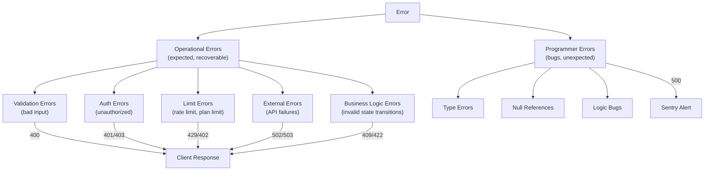

# Error-handling.md — Error Architecture & Recovery Strategies

## 1. Error Taxonomy



---

## 2. Error Class Hierarchy

```typescript
// lib/errors.ts

export class AppError extends Error {
  constructor(
    message: string,
    public code: string,
    public statusCode: number,
    public details?: Record<string, unknown>,
    public isOperational = true,
  ) {
    super(message);
    this.name = this.constructor.name;
    Error.captureStackTrace(this, this.constructor);
  }
}

// ---- Validation Errors (400) ----
export class ValidationError extends AppError {
  constructor(message: string, public fields?: Record<string, string[]>) {
    super(message, 'VALIDATION_ERROR', 400, { fields });
  }
}

// ---- Auth Errors (401, 403) ----
export class AuthenticationError extends AppError {
  constructor(message = 'Authentication required') {
    super(message, 'AUTHENTICATION_REQUIRED', 401);
  }
}

export class AuthorizationError extends AppError {
  constructor(message = 'Insufficient permissions', public requiredScope?: string) {
    super(message, 'INSUFFICIENT_PERMISSIONS', 403, { requiredScope });
  }
}

// ---- Not Found (404) ----
export class NotFoundError extends AppError {
  constructor(resource: string, id?: string) {
    super(`${resource} not found`, 'NOT_FOUND', 404, { resource, id });
  }
}

// ---- Conflict (409) ----
export class ConflictError extends AppError {
  constructor(message: string) {
    super(message, 'CONFLICT', 409);
  }
}

// ---- Rate Limit (429) ----
export class RateLimitError extends AppError {
  constructor(limit: number, windowMs: number, retryAfter?: number) {
    super('Rate limit exceeded', 'RATE_LIMIT_EXCEEDED', 429, {
      limit,
      windowMs,
      retryAfter: retryAfter ?? Math.ceil(windowMs / 1000),
    });
  }
}

// ---- Plan Limit (402) ----
export class PlanLimitError extends AppError {
  constructor(resource: string, limit: number, current: number) {
    super(
      `Plan limit reached for ${resource}`,
      'PLAN_LIMIT_EXCEEDED',
      402,
      { resource, limit, current, upgradeUrl: '/dashboard/billing' },
    );
  }
}

// ---- Insufficient Credits (402) ----
export class InsufficientCreditsError extends AppError {
  constructor(required: number, available: number) {
    super(
      'Insufficient AI credits',
      'INSUFFICIENT_CREDITS',
      402,
      { required, available, topUpUrl: '/dashboard/billing/credits' },
    );
  }
}

// ---- External Service Error (502) ----
export class ExternalServiceError extends AppError {
  constructor(service: string, originalError?: Error) {
    super(
      `External service error: ${service}`,
      'EXTERNAL_SERVICE_ERROR',
      502,
      { service, originalMessage: originalError?.message },
    );
  }
}

// ---- Service Unavailable (503) ----
export class ServiceUnavailableError extends AppError {
  constructor(message = 'Service temporarily unavailable', retryAfter?: number) {
    super(message, 'SERVICE_UNAVAILABLE', 503, { retryAfter });
  }
}
```

---

## 3. HTTP Error Response Format

```typescript
// Consistent error response for all API endpoints
interface ErrorResponse {
  error: {
    code: string;           // Machine-readable error code
    message: string;        // Human-readable message
    details?: unknown;      // Additional context
    requestId: string;      // For support debugging
    timestamp: string;      // ISO 8601
    documentation?: string; // Link to relevant docs
  };
}

// Example responses:

// 400 Validation Error
{
  "error": {
    "code": "VALIDATION_ERROR",
    "message": "Invalid request body",
    "details": {
      "fields": {
        "caption": ["Caption is required"],
        "scheduledAt": ["Must be in the future"]
      }
    },
    "requestId": "req_abc123",
    "timestamp": "2026-10-16T15:00:00Z"
  }
}

// 402 Plan Limit
{
  "error": {
    "code": "PLAN_LIMIT_EXCEEDED",
    "message": "Plan limit reached for channels",
    "details": {
      "resource": "channels",
      "limit": 6,
      "current": 6,
      "upgradeUrl": "/dashboard/billing"
    },
    "requestId": "req_def456",
    "timestamp": "2026-10-16T15:00:00Z"
  }
}

// 429 Rate Limit
{
  "error": {
    "code": "RATE_LIMIT_EXCEEDED",
    "message": "Rate limit exceeded",
    "details": {
      "limit": 120,
      "windowMs": 60000,
      "retryAfter": 45
    },
    "requestId": "req_ghi789",
    "timestamp": "2026-10-16T15:00:00Z"
  }
}
```

---

## 4. Error Code Catalog

| Code | HTTP | Description | User-Facing Message |
|---|---|---|---|
| `VALIDATION_ERROR` | 400 | Invalid input data | "Please check the form for errors" |
| `AUTHENTICATION_REQUIRED` | 401 | Missing or invalid credentials | "Please sign in to continue" |
| `INVALID_API_KEY` | 401 | Invalid or expired API key | "API key is invalid or expired" |
| `INSUFFICIENT_PERMISSIONS` | 403 | Missing role/scope | "You don't have permission to do this" |
| `NOT_FOUND` | 404 | Resource doesn't exist | "We couldn't find what you're looking for" |
| `CONFLICT` | 409 | Duplicate or state conflict | "This action conflicts with the current state" |
| `PLAN_LIMIT_EXCEEDED` | 402 | Plan limit reached | "Upgrade your plan to unlock this feature" |
| `INSUFFICIENT_CREDITS` | 402 | Not enough AI credits | "Top up your AI credits to continue" |
| `RATE_LIMIT_EXCEEDED` | 429 | Too many requests | "Slow down! Try again in a moment" |
| `PUBLISHING_FAILED` | 422 | Platform rejected publish | "Publishing failed: {platform error}" |
| `CHANNEL_EXPIRED` | 422 | OAuth token expired | "Please reconnect your {platform} account" |
| `EXTERNAL_SERVICE_ERROR` | 502 | External API failure | "We're having trouble reaching {service}" |
| `SERVICE_UNAVAILABLE` | 503 | Internal service down | "We'll be back shortly" |
| `INTERNAL_ERROR` | 500 | Unexpected bug | "Something went wrong. We're looking into it" |

---

## 5. Global Error Handler

```typescript
// middleware/errorHandler.ts
import { Sentry } from '@sentry/node';

export function globalErrorHandler(err: Error, req: Request, res: Response) {
  const requestId = req.headers['x-request-id'] || crypto.randomUUID();
  
  if (err instanceof AppError && err.isOperational) {
    // Operational error — expected, return to client
    res.status(err.statusCode).json({
      error: {
        code: err.code,
        message: err.message,
        details: err.details,
        requestId,
        timestamp: new Date().toISOString(),
      },
    });
    
    // Log operational errors at warn level
    logger.warn({
      type: 'operational_error',
      code: err.code,
      message: err.message,
      requestId,
      workspaceId: req.auth?.workspaceId,
      path: req.path,
      method: req.method,
    });
    
  } else {
    // Programmer error — unexpected, report to Sentry
    Sentry.captureException(err, {
      tags: { requestId },
      extra: {
        path: req.path,
        method: req.method,
        workspaceId: req.auth?.workspaceId,
      },
    });
    
    logger.error({
      type: 'unexpected_error',
      message: err.message,
      stack: err.stack,
      requestId,
      path: req.path,
    });
    
    res.status(500).json({
      error: {
        code: 'INTERNAL_ERROR',
        message: 'An unexpected error occurred',
        requestId,
        timestamp: new Date().toISOString(),
      },
    });
  }
}
```

---

## 6. External API Retry Strategy

```typescript
// lib/retry.ts
interface RetryConfig {
  maxAttempts: number;
  baseDelayMs: number;
  maxDelayMs: number;
  retryableStatuses: number[];
}

const PLATFORM_RETRY_CONFIG: Record<string, RetryConfig> = {
  meta: {
    maxAttempts: 3,
    baseDelayMs: 1000,
    maxDelayMs: 30000,
    retryableStatuses: [429, 500, 502, 503],
  },
  openai: {
    maxAttempts: 3,
    baseDelayMs: 2000,
    maxDelayMs: 60000,
    retryableStatuses: [429, 500, 502, 503],
  },
  stripe: {
    maxAttempts: 3,
    baseDelayMs: 500,
    maxDelayMs: 10000,
    retryableStatuses: [429, 500, 502, 503],
  },
};

async function withRetry<T>(
  fn: () => Promise<T>,
  config: RetryConfig,
): Promise<T> {
  let lastError: Error;
  
  for (let attempt = 1; attempt <= config.maxAttempts; attempt++) {
    try {
      return await fn();
    } catch (err) {
      lastError = err as Error;
      
      const status = (err as any)?.response?.status;
      if (!config.retryableStatuses.includes(status)) throw err;
      
      if (attempt < config.maxAttempts) {
        const delay = Math.min(
          config.baseDelayMs * Math.pow(2, attempt - 1) + Math.random() * 1000,
          config.maxDelayMs,
        );
        await sleep(delay);
      }
    }
  }
  
  throw lastError!;
}
```

---

## 7. Circuit Breaker Pattern

```typescript
// lib/circuitBreaker.ts
class CircuitBreaker {
  private failures = 0;
  private lastFailureTime = 0;
  private state: 'CLOSED' | 'OPEN' | 'HALF_OPEN' = 'CLOSED';
  
  constructor(
    private threshold: number = 5,         // Failures before opening
    private resetTimeoutMs: number = 60000, // Time before half-open
  ) {}
  
  async execute<T>(fn: () => Promise<T>): Promise<T> {
    if (this.state === 'OPEN') {
      if (Date.now() - this.lastFailureTime > this.resetTimeoutMs) {
        this.state = 'HALF_OPEN';
      } else {
        throw new ServiceUnavailableError('Circuit breaker is open');
      }
    }
    
    try {
      const result = await fn();
      this.onSuccess();
      return result;
    } catch (err) {
      this.onFailure();
      throw err;
    }
  }
  
  private onSuccess() {
    this.failures = 0;
    this.state = 'CLOSED';
  }
  
  private onFailure() {
    this.failures++;
    this.lastFailureTime = Date.now();
    if (this.failures >= this.threshold) {
      this.state = 'OPEN';
    }
  }
}

// Per-service circuit breakers
const breakers = {
  meta: new CircuitBreaker(5, 60000),
  openai: new CircuitBreaker(3, 120000),
  gmail: new CircuitBreaker(5, 60000),
};
```

---

## 8. Queue Error Handling

```typescript
// BullMQ job failure handling
const publishWorker = new Worker('social:publish', async (job) => {
  try {
    await publishToPlaftorm(job.data);
  } catch (err) {
    // Update post status on final failure
    if (job.attemptsMade >= job.opts.attempts!) {
      await db.postChannel.update({
        where: { id: job.data.postChannelId },
        data: {
          status: 'FAILED',
          error: err.message,
        },
      });
      
      // Notify user
      await sendNotification(job.data.workspaceId, {
        type: 'post_failed',
        postId: job.data.postId,
        error: err.message,
      });
    }
    
    throw err; // Re-throw for BullMQ retry
  }
}, {
  connection: redis,
  concurrency: 5,
  limiter: { max: 10, duration: 1000 },
  settings: {
    backoffStrategy: (attemptsMade) => {
      return Math.min(1000 * Math.pow(2, attemptsMade), 300000); // Max 5 min
    },
  },
});

// Dead letter queue processing
const dlqWorker = new Worker('dead-letter', async (job) => {
  logger.error({
    type: 'dead_letter',
    queue: job.data.originalQueue,
    jobId: job.data.originalJobId,
    error: job.data.lastError,
    data: job.data,
  });
  
  // Alert ops team
  await alertOps('Dead letter job', job.data);
});
```

---

## 9. Client-Side Error Handling

```typescript
// React Error Boundary
'use client';

export function ErrorBoundary({ children }: { children: React.ReactNode }) {
  return (
    <ErrorBoundaryPrimitive
      fallback={({ error, reset }) => (
        <div className="flex flex-col items-center gap-4 p-8">
          <h2 className="text-lg font-semibold">Something went wrong</h2>
          <p className="text-sm text-muted">{getUserMessage(error)}</p>
          <button onClick={reset} className="btn btn-primary">Try again</button>
        </div>
      )}
    >
      {children}
    </ErrorBoundaryPrimitive>
  );
}

// API client error handling
async function apiCall<T>(url: string, options?: RequestInit): Promise<T> {
  const res = await fetch(url, options);
  
  if (!res.ok) {
    const body = await res.json().catch(() => ({}));
    const error = body.error;
    
    switch (res.status) {
      case 401:
        redirect('/login');
        break;
      case 402:
        toast.error(error?.message || 'Upgrade required', {
          action: { label: 'Upgrade', onClick: () => router.push('/billing') },
        });
        break;
      case 429:
        toast.error(`Rate limit exceeded. Try again in ${error?.details?.retryAfter}s`);
        break;
      default:
        toast.error(error?.message || 'Something went wrong');
    }
    
    throw new ApiError(res.status, error);
  }
  
  return res.json();
}
```

---

## 10. Monitoring & Alerting Rules

| Alert | Condition | Severity | Channel |
|---|---|---|---|
| Error rate spike | >5% of requests return 5xx in 5 min | Critical | PagerDuty + Slack |
| External API down | Circuit breaker opens | High | Slack |
| Queue backlog | >1000 jobs pending for >10 min | High | Slack |
| Dead letter job | Any job reaches DLQ | Medium | Slack |
| Auth failures | >50 failed logins from same IP in 5 min | High | Slack |
| Slow responses | P95 > 2s for 5 min | Medium | Slack |
| Disk usage | >80% on any volume | Medium | Email |
| Credit exhaustion | Workspace hits 0 credits | Low | In-app notification |
